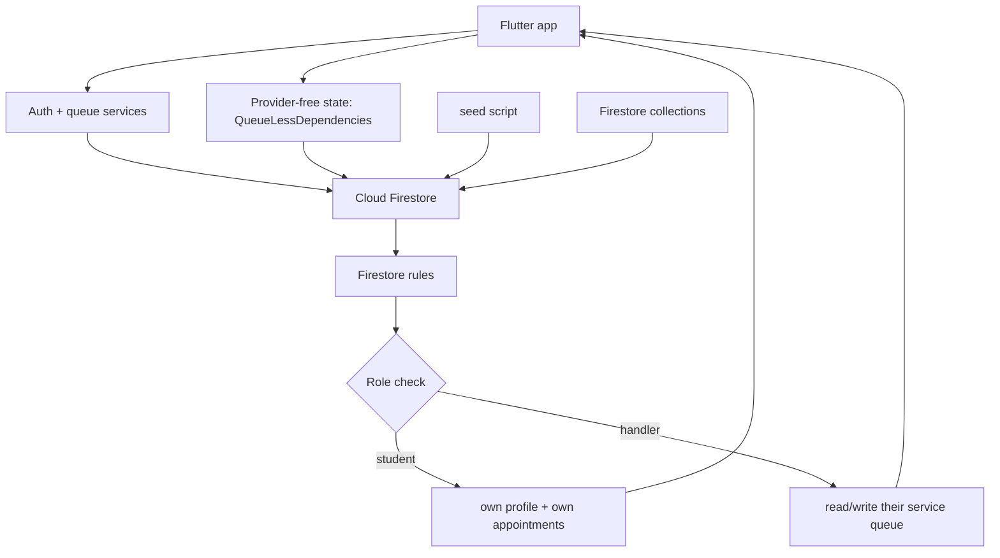

# QueueLess

**Smart queue & appointment manager for Bahria University** — replaces the awkward
"take a numbered ticket and wait in line" experience for university offices and
campus cafés, for both students and the staff who serve them.

> Placeholder section — **TODO**: add screenshots/GIFs of the actual app here.

## The problem

Students wait in physical queues at the advisor's office, the departmental
(administrative) office, the accounts office, and campus cafés. Staff members
manually track who is waiting and who is next. There is no way to see where you
are in line, how long you will wait, or whether the office is open — and no
role-based view that lets an advisor, a department head, or canteen staff see
only the queue they are responsible for.

QueueLess digitises the token/bullet system: students book a slot, see their
position and estimated wait, and hand their token to staff. Staff get a focused
view of their own queue and can start and complete appointments.

## Features by role

### Student
- Browse the campus services (advisor meeting, HOD meeting, accounts office, canteens).
- Book an appointment slot for a date/time; the slot becomes "busy" when taken.
- Café seat booking (choose a venue and seats, with a duration cap).
- View your own appointment list, token number, position in the queue and an
  estimated wait time.
- Cancel a pending appointment.

### Advisor / Department head / Cafeteria staff (handlers)
- Login as a handler; the dashboard opens straight to the queue for the service
  that matches your role (e.g. HOD Meeting, Accounts Office, a Canteen).
- Start a pending appointment (moves it to in-progress), complete it, or cancel it.
- Toggle a service "open"/"closed" so students can only book when it is accepting
  people (note: the current Firestore rules do not yet enforce this flow).
- See the public "Now Serving / Up Next" queue for your service.

### Anyone (authenticated)
- Login/register with email and password; registration requires a handler
  security code so staff accounts cannot be created by students.


## Tech stack

| Layer | Technology |
|---|---|
| Mobile framework | Flutter (Dart), Material 3 |
| State management | InheritedWidget (`QueueLessDependencies`) — a lightweight, framework-native state container |
| Backend services | Firebase Auth, Cloud Firestore |
| UI | Material 3, google_fonts, font_awesome_flutter |
| Utilities | intl (date formatting), flutter_lints |

Cloud Functions are **not** included in this project yet (todo).

## Architecture (mermaid)



## Data model (Cloud Firestore)

### Collections

| Collection | Key fields |
|---|---|
| `services` | `name`, `description`, `location`, `minutesPerPerson`, `isOpen`, `createdAt`, `updatedAt` |
| `users` | `name`, `email`, `role` (`student` \| `handler`), `handlerRole`, `canteen`, `createdAt`, `updatedAt` |
| `appointments` | `serviceId`, `serviceName`, `userId`, `userName`, `userEmail`, `userEnrollment`, `createdAt`, `scheduledTime`, `tokenNumber`, `status` (`pending` \| `inProgress` \| `completed` \| `cancelled`), `seatNumbers`, `durationMinutes`, `updatedAt` |

### Roles
- `UserRole.student` and `UserRole.handler`. The app's `AppUser` model carries
  optional `handlerRole` ("Student Advisor", "HOD Coordinator", "Canteen Staff")
  and `canteen` fields to distinguish handler subtypes.

## Firestore security rules

`firestore.rules` **exists**, and it was committed **completely open** (`allow read, write: if true`).
That is no longer the default: it has been tightened so that:

- **Users** can read/write **only their own profile** (`users/{uid}`).
- **Services** are readable by any signed-in user; writeable by handlers.
- **Appointments**: a user can create/read their own appointment and update their
  own appointment (e.g. to cancel); handlers can read all appointments and update
  the queue for their service; **deletion is disabled**.
- No anonymous/unauthenticated access and no cross-user data access.

> ⚠️ These rules **must be validated with the Firebase Emulator Suite** (see
> `firestore.rules.test.js`) before the project is used with real user data.
> The README "Getting started" section below covers how to run the emulator tests.

## Getting started

### Prerequisites
- Flutter 3.47.9+ stable and the Dart SDK (the project requires `sdk: ^3.9.2`).
- A Firebase project (see below).
- (Optional) Firebase Emulator Suite + Java to run the rules tests locally.

### 1. Create a Firebase project
1. Go to the [Firebase Console](https://console.firebase.google.com/) and create a
   project named e.g. `bahria-uni-queueless-app`.
2. Enable **Authentication** and set up **Email/Password** sign-in.
3. Enable **Cloud Firestore** (in Native/Android or Web config) for the project.
4. From project settings, copy the **Web API key** and other config values.
5. (Optional) Install the Firebase CLI and login (`npm i -g firebase-tools`,
   `firebase login`) for emulator/deploy commands.

### 2. Configure Firebase credentials (no real keys committed)
The project uses a single config file `lib/config/firebase_config.dart`. It
ships with **placeholder** values so the app compiles, tests, and boots without
needing a real Firebase project. Replace them with your own project config
(below) before running locally.

Edit `lib/config/firebase_config.dart` and replace the placeholder values with
your Firebase project's Web config values (API key, Auth domain, project ID, etc.).
Only commit the file with your own (or placeholder) values — never push real keys.

### 3. Install dependencies and run
```bash
flutter pub get
flutter analyze      # 0 errors; warnings/infos are mostly print() usage
flutter test         # 8 tests pass (widget smoke + in-memory queue logic)
flutter run          # run the app on an emulator/device
```

### 4. First-run seed data
On first launch the app's startup path seeds a small set of campus services into
`services` (if none exist) and creates the Auth users as people sign up.


## Project structure

```
.
├── .firebaserc           # Firebase project alias
├── .github/
│   └── workflows/
│       └── flutter.yml   # CI: pub get, analyze, test
├── firebase.json           # Firestore rules + web hosting config
├── firestore.rules         # Role-based Firestore rules
├── firestore.rules.test.js # Emulator rules unit tests
├── pubspec.yaml
├── README.md
├── LICENSE
├── CONTRIBUTING.md
├── lib/
│   ├── main.dart                # App bootstrap + dependency provider
│   ├── config/
│   │   ├── firebase_config.example.dart  # template (placeholders)
│   │   └── firebase_config.dart         # REAL keys (gitignored)
│   ├── models/
│   │   ├── user.dart, service.dart, appointment.dart
│   ├── services/
│   │   ├── queue_service.dart (abstraction)
│   │   ├── impl/
│   │   │   ├── firebase_auth_service.dart
│   │   │   ├── firebase_queue_service.dart
│   │   │   ├── firebase_queue_service_simple.dart
│   │   │   ├── dummy_auth_service.dart
│   │   │   └── dummy_queue_service.dart
│   │   └── auth_service.dart
│   ├── screens/
│   │   ├── student/        # Student dashboard, booking, queue status, café booking
│   │   ├── handler/        # Handler dashboard (active)
│   │   ├── auth/           # Login / register
│   │   ├── public/         # Public queue display
│   │   └── splash/         # Splash screen
│   ├── utils/
│   └── widgets/
└── test/
    ├── widget_test.dart              # Widget smoke test
    └── queue_logic_test.dart         # In-memory queue logic tests
```

## Test

- `flutter test` runs **8 tests**: the widget smoke test and an in-memory
  queue-service suite covering booking, token numbers, position in queue,
  estimated wait, mark-in-progress/complete/cancel, and per-user appointment lists.

## Known limitations

- Firestore rules were, at the time of this audit, **completely open**.
  They are now role-scoped, but they have **not been validated against the
  Firebase Emulator Suite** (Java is required) — treat them as a security-first
  starting point.
- The handler dashboard opens on a per-role service; there is no central
  "all queues for all staff" dashboard.
- Café seat booking keeps its seat map in memory only for the current session
  (not persisted to Firestore), so seats can be re-booked by another user on a
  fresh session. Seat limits are soft.
- There is no Cloud Function back end: price/queue logic executes in the client.
- "10-second bookings" is **not** something this app measures — no timing or
  throughput instrumentation exists anywhere in the code. Booking a slot means a
  user-facing wait of the chosen slot time; queue position and estimated wait
  minutes are computed from token order and the service's configured
  `minutesPerPerson`.
- Registration for handler accounts uses a hard-coded security phrase
  (`accessgranted`). This is a placeholder gate, not real identity proof.

## Roadmap

- Add Cloud Functions for server-side booking/queue/billing logic and to enforce
  queue rules that the client cannot.
- Add Firestore rules validation to CI via the emulator (needs Java).
- Persist café seat bookings and seat availability to Firestore.
- Replace the hard-coded security code with a real staff-provisioning step.
- Better seed/teardown tooling for local development and the emulator.
- Add a real "10-second booking" measurement harness if instant booking is a
  product requirement (it is not currently measurable).

